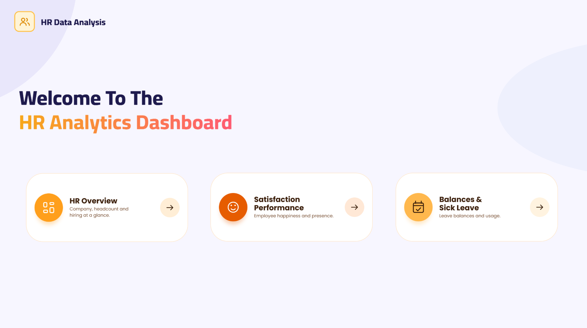
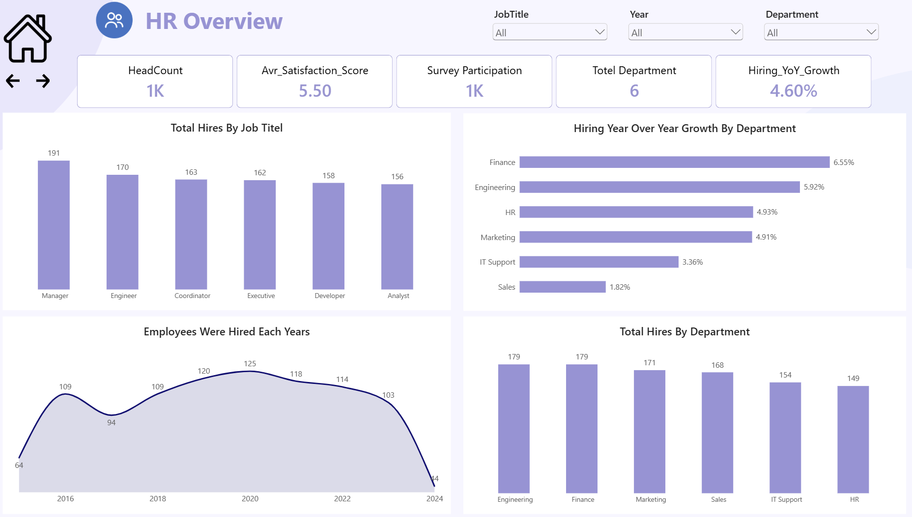
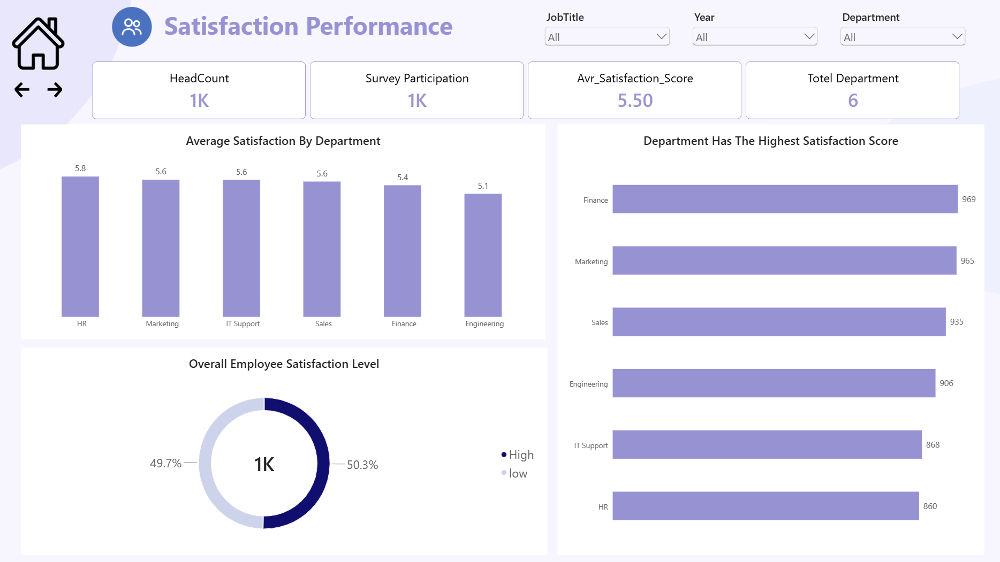
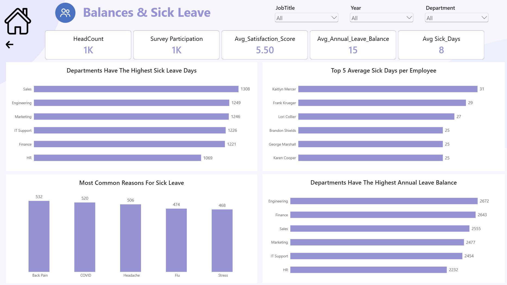

# HR Data Analysis | Power BI Dashboard

An interactive Power BI dashboard that analyzes headcount, hiring trends, employee satisfaction, annual leave balances, and sick leave across departments and job titles.

## About the Project

This project turns HR data into a three-page dashboard that answers questions such as:

- How many employees does the company have, and how has hiring changed over the years?
- Which departments and job titles are hired the most?
- How satisfied are employees, and which departments are the happiest?
- How much leave do employees have left, and which departments take the most sick leave?
- What are the most common reasons for sick leave?

## Tools Used

- Power BI Desktop
- DAX measures (headcount, hiring growth, satisfaction score, and leave metrics)
- Interactive slicers (Job Title, Year, Department)
- Page navigation buttons and a custom dashboard design

## Dashboard Pages

### 1. Home

A landing page with navigation buttons to the three report pages.

### 2. HR Overview

**KPIs:** Headcount (1K), Average Satisfaction Score (5.50), Survey Participation (1K), Total Departments (6), Hiring YoY Growth (4.60%)

**Visuals:**
- Total Hires by Job Title
- Hiring Year-over-Year Growth by Department
- Employees Hired Each Year
- Total Hires by Department

### 3. Satisfaction Performance

**KPIs:** Headcount (1K), Survey Participation (1K), Average Satisfaction Score (5.50), Total Departments (6)

**Visuals:**
- Average Satisfaction by Department
- Overall Employee Satisfaction Level (High vs. Low)
- Department Satisfaction Score (total)

### 4. Balances & Sick Leave

**KPIs:** Headcount (1K), Survey Participation (1K), Average Satisfaction Score (5.50), Average Annual Leave Balance (15), Average Sick Days (8)

**Visuals:**
- Departments with the Highest Sick Leave Days
- Top Average Sick Days per Employee
- Most Common Reasons for Sick Leave
- Departments with the Highest Annual Leave Balance

## Key Insights

### Workforce and hiring
- The company has about **1,000 employees** across **6 departments**, and hiring is spread evenly across job titles: Manager (191), Engineer (170), Coordinator (163), Executive (162), Developer (158), and Analyst (156).
- **Engineering and Finance** have the most hires (**179 each**), followed by Marketing (171) and Sales (168). **HR** has the fewest (149).
- Hiring **peaked in 2020 (125 hires)** and has declined every year since: 118, 114, 103, and 44 in 2024.
- **Finance (6.55%)** and **Engineering (5.92%)** have the highest hiring growth year over year, while **Sales (1.82%)** has the lowest. The overall hiring growth is **4.60%**.

### Satisfaction
- The average satisfaction score is **5.50**, and survey participation matches the headcount, so the results represent nearly the whole workforce.
- Satisfaction is split almost evenly: **50.3%** of employees are highly satisfied and **49.7%** have low satisfaction.
- **HR** has the highest average satisfaction (**5.8**), followed by Marketing, IT Support, and Sales (**5.6** each). **Engineering** has the lowest (**5.1**).
- Finance has the highest *total* satisfaction score (969) and HR the lowest (860), but this reflects department size: HR is the smallest department and still has the best average.

### Leave and sick days
- The average annual leave balance is **15 days**, and the average employee takes **8 sick days**.
- **Sales** has the most total sick leave days (**1,308**), followed by Engineering (1,249) and Marketing (1,246). **HR** has the fewest (1,069).
- Per employee (calculated from the dashboard figures), **IT Support (about 8.0)** and **Sales (about 7.8)** have the most sick days, and **Finance (about 6.8)** has the fewest.
- The most common sick leave reasons are **Back Pain (532)**, **COVID (520)**, **Headache (506)**, **Flu (474)**, and **Stress (468)**, a fairly even spread.
- A few employees take far more sick leave than average, with the highest individual counts between **25 and 31 days**, about three to four times the average.
- **Engineering** holds the largest unused annual leave balance (**2,672 days**), followed by Finance (2,643). **HR** has the smallest (2,232).

## Recommendations

- Look into **Engineering**: it has the lowest satisfaction (5.1) and the largest unused leave balance. This may point to heavy workload or burnout, so encourage employees to take their leave.
- Address sick leave in **Sales and IT Support**, which have the highest sick days per employee.
- Launch wellness initiatives targeting **back pain** (ergonomics) and **stress**, two of the top five sick leave reasons.
- With half of employees reporting low satisfaction, run follow-up surveys and learn from the practices in **HR and Marketing**.
- Review the hiring slowdown since 2020 against current staffing needs.
- Offer individual support to employees with unusually high sick leave.
